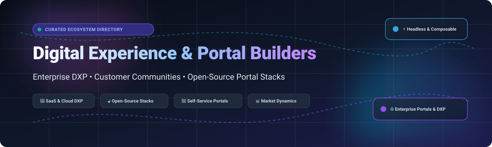

  

# 🌐 Awesome Digital Experience & Portal Builders 🚀

### *The Curated Architecture & Directory for Modern DXPs, Customer Portals, Community Engines & Headless Experience Platforms*

  <b>Discover high-performance SaaS solutions and top-tier open-source self-hosted stacks to create branded customer portals, partner hubs, intranet knowledge engines, and composable digital experiences.</b>

---

## 📑 Table of Contents

- [🌟 Overview](#-overview)
- [📈 Sector Overview & Market Dynamics](#-sector-overview--market-dynamics)
- [💼 SaaS & Enterprise Hosted Platforms](#-saas--enterprise-hosted-platforms)
- [🔓 Open-Source GitHub Projects (Ranked by Stars)](#-open-source-github-projects-ranked-by-stars)
- [🛠️ Recommended Architecture Combinations](#️-recommended-architecture-combinations)
- [🤝 How to Contribute](#-how-to-contribute)
- [💖 Support & Sponsorship](#-support--sponsorship)
- [⭐ Star History](#-star-history)
- [📜 Disclaimer](#-disclaimer)

---

## 🌟 Overview

Welcome to the **Awesome Digital Experience & Portal Builder** directory! In modern digital enterprise operations, **Digital Experience Platforms (DXP)**, **customer portals**, **partner extranets**, and **headless experience layers** form the operational backbone of customer engagement, retention, and self-service.

Whether you need a full enterprise-grade turnkey cloud platform (Salesforce Experience Cloud, Adobe Experience Manager, Sitecore) or an autonomous, self-hosted, vendor-neutral open-source stack (Strapi, Payload, Directus, Grav, Liferay), this list catalogs the leading technologies with verified pricing, free tier limits, company sizes, and active GitHub_Stars.

---

## 📈 Sector Overview & Market Dynamics

The global Digital Experience Platform (DXP) and portal software market is estimated at approximately **$16B–$19B in 2025–2026**, growing at a double-digit CAGR toward over $30B by the early 2030s. The sector exhibits a bifurcated market structure: it is **moderately concentrated** at the top-tier enterprise level—dominated by hyperscale and suite incumbents like Salesforce, Adobe, and Sitecore capturing large recurring contracts—while the broader ecosystem remains **highly fragmented** across composable headless CMS engines, mid-market website/portal builders, and specialized community platforms.

---

## 💼 SaaS & Enterprise Hosted Platforms

*Enterprise DXP, visual experience builders, community platforms, and managed website solutions sorted by company size/valuation (descending).*

| Platform | Company Size (Valuation / Revenue) | Pricing (Starting Tier) | Free Tier Limits | Key Highlights & Capabilities |
| :--- | :--- | :--- | :--- | :--- |
| **[Salesforce Experience Cloud](https://www.salesforce.com/products/experience-cloud/)** | ~$188B MCap / ~$41.5B ARR | $5–$10/member/month (Customer Community) or ~$2–$4/login | 30-day free trial; full Experience Builder access with sample CRM data and sandbox limits | 🎯 Branded help centers, communities, and portals directly tied into CRM workflows; Einstein AI recommendations; Service Cloud integration. |
| **[Adobe Experience Manager](https://business.adobe.com/products/experience-manager/sites/aem-sites.html)** | ~$100B MCap / ~$23.8B Rev | Starting ~$30,000–$100,000/year base tier | No public free tier or self-service trial; guided enterprise proof-of-concept (PoC) / sandbox demo via sales | 🎨 Tier-one enterprise DXP and digital asset management (DAM); Edge Delivery Services; Quick Site Creation templates. |
| **[HubSpot Content Hub](https://www.hubspot.com/)** | ~$12B MCap / ~$3.4B ARR | $15–$20/seat/month (Starter tier) | Free forever: up to 30 website/landing pages, basic blog posts, shared domain, mandatory HubSpot branding | 🧲 All-in-one CMS connected to HubSpot CRM; drag-and-drop editor; dynamic smart content, membership portals, and lead capture. |
| **[WordPress VIP](https://wpvip.com/)** | ~$7.5B Val (Automattic) / ~$500M ARR | ~$2,083/month ($25,000/year billed annually) | 14-day guided sandbox trial available upon sales engagement | ⚡ Enterprise-grade managed WordPress infrastructure; Parse.ly content analytics; Gutenberg editor; decoupled & headless capabilities. |
| **[Squarespace Enterprise](https://www.squarespace.com/enterprise)** | ~$7.2B Private Acq / ~$1B+ Rev | $16/month (billed annually) for standard starter site tier | 14-day free trial: private password-protected site (`*.squarespace.com`), search indexing disabled, no live payments | 🏢 Multi-site centralized dashboard, team role permissions, page drafts, collaborative design workflows, and integrated marketing. |
| **[Webflow Enterprise](https://webflow.com/enterprise)** | ~$4B Valuation / ~$212M+ ARR | $15/month (Basic site plan, billed annually) | Free forever (Starter): 2 static pages, 1 GB bandwidth, publish to `.webflow.io` staging domain, up to 2 unhosted projects | ✨ Visual web design platform with design system governance; localized content; native experiments and enterprise security controls. |
| **[Wix Studio](https://www.wix.com/studio)** | ~$3.5B MCap / ~$1.99B Rev | $19/month (Basic Studio plan, billed annually) | Free forever: free agency workspace & unlimited staging sites, but live unupgraded sites capped at 500 MB storage, 1 GB bandwidth, Wix subdomain & ads, no payments | 🛠️ Tailored for design agencies and enterprises; responsive AI canvas, grid-based editor, version control, and client mode. |
| **[Sitecore Experience Platform](https://www.sitecore.com/platform/experience-platform)** | ~$2B+ Val (EQT) / ~$500M ARR | ~$5,000–$6,600/month ($60,000–$80,000/year base XM/XM Cloud) | 30-day developer evaluation license / guided partner sandbox environment | 🧠 Enterprise composable & all-in-one DXP; advanced personalization engine, customer data platform (CDP), and omni-channel delivery. |
| **[Liferay DXP](https://www.liferay.com/)** | Bootstrapped / Est. ~$150M–$240M Rev | ~$2,000–$3,300/month ($25,000–$40,000/year base self-hosted) | 30-day DXP Sandbox Cloud Trial (also provides a restricted non-commercial Free Tier activation key; separate open-source LGPL CE version) | 🏛️ Portal platform for customer, partner, supplier, and employee intranets; built-in CMS, DAM, low-code forms, and granular permissions. |
| **[Bettermode](https://bettermode.com/)** | Venture-backed / Est. ~$3.1M ARR | $149/month (Starter tier, billed annually) | 14-day free trial on Starter plan with up to 5 collaborators and core app access | 👥 Community hub & customer portal platform; white-label branding, modular Spaces, SSO authentication, and CRM sync. |

---

## 🔓 Open-Source GitHub Projects (Ranked by Stars)

*Self-hosted digital experience platforms, headless CMS backbones, community portals, and low-code portal builders. Sorted by GitHub Stars_Count in descending order.*

1. **[Strapi](https://github.com/strapi/strapi)**   
   Leading open-source headless CMS (JavaScript/TypeScript, MIT). Features an intuitive administrative dashboard, customizable REST and GraphQL APIs, dynamic role-based access control (RBAC), and webhooks. Ideal as an API-first content backend for omni-channel portals.

2. **[NocoDB](https://github.com/nocodb/nocodb)**   
   Open-source Airtable alternative that transforms any PostgreSQL, MySQL, SQL Server, or SQLite database into a smart spreadsheet portal. Features instant REST/GraphQL APIs, Kanban/Form views, team collaboration, and granular user roles.

3. **[Discourse](https://github.com/discourse/discourse)**   
   Modern, open-source discussion and community platform (GPL-2.0). Designed for high-trust community hubs, customer support knowledge portals, SSO integrations, badges, and notification workflows.

4. **[Payload](https://github.com/payloadcms/payload)**   
   Open-source Next.js & TypeScript full-code headless CMS and application framework (MIT). Delivers native React components, custom layout fields, deep authentication, localized content, and instant SQLite/MongoDB/Postgres support.

5. **[ToolJet](https://github.com/ToolJet/ToolJet)**   
   Open-source low-code platform to build internal employee portals, customer support tools, and business dashboards. Features 50+ pre-built UI components, integrations with dozens of databases and SaaS APIs, and granular access policies.

6. **[Appsmith](https://github.com/appsmithorg/appsmith)**   
   Open-source low-code framework to build admin panels, customer portals, and internal workflows. Connects to PostgreSQL, MongoDB, REST/GraphQL APIs, and supports custom JavaScript for frontend logic.

7. **[Outline](https://github.com/outline/outline)**   
   Fast, collaborative team knowledge base and documentation portal built with React and Node.js. Features Markdown editing, real-time sync, permissions, and custom subdomain support.

8. **[Directus](https://github.com/directus/directus)**   
   Open-source data platform and Headless CMS wrapping SQL databases with an intuitive No-Code Data Studio and dynamic REST/GraphQL APIs. Perfect for customer portals, data dashboards, and internal operations.

9. **[WordPress](https://github.com/WordPress/WordPress)**   
   World's most widely adopted open-source content management system (GPL-2.0). Extensible with thousands of portal, membership, and LMS plugins (BuddyPress, MemberPress, WooCommerce) to power any self-hosted experience.

10. **[Grav](https://github.com/getgrav/grav)**   
    Modern, fast flat-file CMS powered by PHP, Markdown, Twig, and Symfony (MIT). Requires no database setup, making it ideal for lightweight help centers, documentation portals, and static microsites.

11. **[Joomla](https://github.com/joomla/joomla-cms)**   
    Enterprise-ready open-source CMS (GPL-2.0) with native multilingual support, granular Access Control Lists (ACL), and extensive community extension support for customer and membership portals.

12. **[Drupal](https://github.com/drupal/drupal)**   
    Enterprise-grade open-source CMS and digital experience framework (GPL-2.0). Excels at complex taxonomies, multi-site management, high-volume government and enterprise portal ecosystems.

13. **[Liferay Portal CE](https://github.com/liferay/liferay-portal)**   
    Open-source Community Edition (LGPL-2.1) of the industry-standard Liferay enterprise portal. Delivers modular portlets, content management, user segmentation, workflow automation, and collaboration tools.

14. **[Richie](https://github.com/openfun/richie)**   
    Open-source CMS designed specifically for education and course discovery portals (Python/Django, MIT). Supports rich course catalogs, organization directories, and student profiles.

15. **[SEBLOD](https://github.com/Octopoos/SEBLOD)**   
    Advanced Content Construction Kit (CCK) and application builder for Joomla. Allows developers to design custom relational databases, custom input interfaces, and tailored portal frontends.

16. **[Visually](https://github.com/Git002/Visually)**   
    Drag-and-drop website and UI builder that generates clean Svelte code. Allows creators to design responsive web layouts with zero vendor lock-in.

17. **[p3ol/oak](https://github.com/p3ol/oak)**   
    Modern, lightweight, modular page builder and block-based experience designer for self-hosted websites and web portals.

18. **[AntCMS](https://github.com/AntCMS-org/AntCMS)**   
    Ultra-lightweight flat-file content management system designed for speed, simplicity, and low-resource portal hosting.

19. **[Ibexa Experience](https://github.com/ibexa/experience)**   
    Modular PHP/Symfony enterprise DXP framework enabling headless content delivery, multi-channel commerce, and digital experience composition.

20. **[Gatewaze](https://github.com/gatewaze/gatewaze)**   
    Modular open-source community portal platform featuring member management, event schedules, communications, and Helm charts for self-hosted Kubernetes/Supabase deployments.

21. **[sivujetti](https://github.com/sivujetti/sivujetti)**   
    Self-hosted, lightweight website and portal page builder designed to provide full data sovereignty without external SaaS dependencies.

---

## 🛠️ Recommended Architecture Combinations

For engineering teams constructing custom, vendor-neutral enterprise portals:

- **Customer Knowledge & Help Center:** [Grav](https://github.com/getgrav/grav) or [Outline](https://github.com/outline/outline) + [Discourse](https://github.com/discourse/discourse) for community interaction.
- **Enterprise Partner / Supplier Extranet:** [Directus](https://github.com/directus/directus) or [NocoDB](https://github.com/nocodb/nocodb) on PostgreSQL + [Appsmith](https://github.com/appsmithorg/appsmith) / [ToolJet](https://github.com/ToolJet/ToolJet) for front-of-house UI.
- **Omni-Channel Headless Portal:** [Strapi](https://github.com/strapi/strapi) or [Payload](https://github.com/payloadcms/payload) + Next.js / Nuxt frontend + n8n automation orchestrator.

---

## 🤝 How to Contribute

Contributions are warmly welcome! Help expand and refine this ecosystem directory:

1. 🍴 **Fork the repository** on GitHub.
2. 🌿 **Create a new branch** (`git checkout -b feature/add-new-portal`).
3. 📝 **Add or update an entry** in `README.md` following the existing format (include name, official link, Stars_Badge, and clear technical summary).
4. 🚀 **Submit a Pull Request** with a concise description of your additions.

---

## 💖 Support & Sponsorship

Thank you for exploring and utilizing this curated directory! If you find this resource valuable for your research, team, or projects, please consider supporting the project:

- ⭐ **Star this repository** to help others discover it.
- 🍴 **Fork and share** with colleagues and developers.
- ☕ **Buy a coffee & sponsor ongoing open-source maintenance:**  
  👉 **[Sponsor on GitHub Sponsors](https://github.com/sponsors/ishandutta2007)**

---

## ⭐ Star History

---

## 📜 Disclaimer

- ℹ️ This repository is a **community-curated directory** intended for educational and architectural evaluation purposes. It does not constitute a commercial endorsement.
- 🔒 Digital experience platforms handling user authentication and personally identifiable information (PII) must comply with international privacy regulations (such as GDPR, CCPA, and HIPAA).
- 🛡️ Self-hosted open-source software deployments require active security patching, SSL/TLS encryption, and production hardening.

---

  <b>Made with ❤️ for digital experience teams, community architects, and software engineers worldwide.</b>

